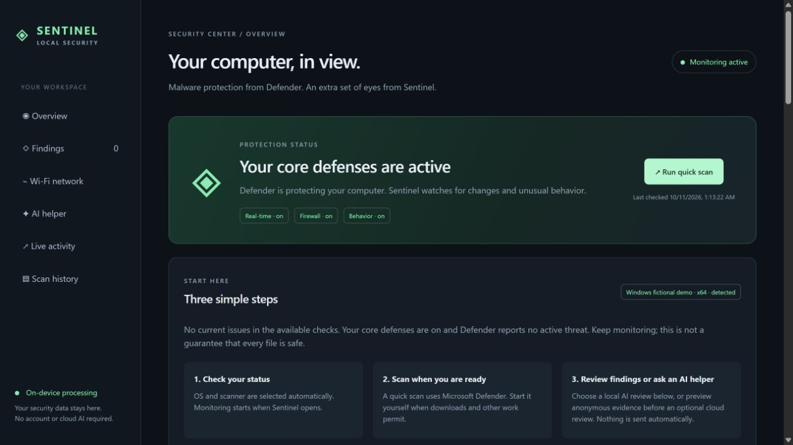
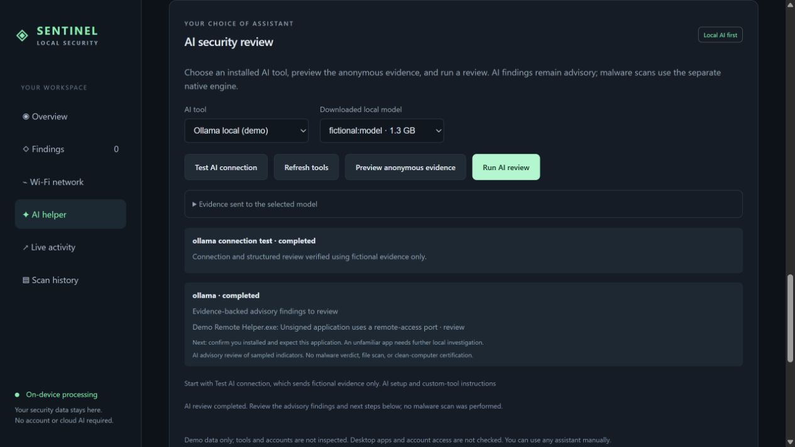
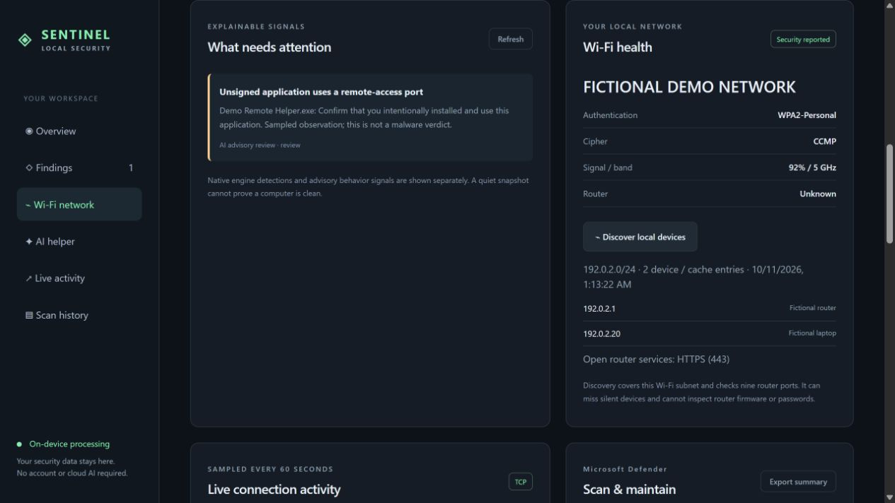

# Sentinel Local — Local AI Security Monitor & Windows Defender Dashboard

**Understand your computer's protection, connection activity, and Wi-Fi security in one private dashboard.**

[](LICENSE)
[](https://github.com/dibyapp/sentinel-local/actions/workflows/validate.yml)
[](docs/PLATFORMS.md)

Sentinel Local is an **open-source endpoint security monitor** with local Ollama review, Microsoft Defender scan controls, optional ClamAV folder scans, and bounded Wi-Fi checks. Use installed AI tools to explain anonymous security indicators. Core monitoring needs no account or cloud subscription.

**Desktop beta:** Microsoft Defender and separately configured OS protections handle malware blocking. Sentinel provides observations and advisory analysis. It is not an independently certified antivirus engine. Windows and Linux x64 have local validation; macOS and ARM64 need native validation.

[Get started](docs/INSTALLATION.md) · [Download the beta](https://github.com/dibyapp/sentinel-local/releases/tag/v0.5.1-beta.1) · [AI tools](docs/AI_REVIEW.md) · [Privacy](SECURITY.md) · [Contribute](CONTRIBUTING.md)



*Every screenshot uses the reproducible fictional demo. No owner's computer, network, files, or credentials appear.*

## Start in three steps

1. **Choose your install.** Download the Windows x64 or Linux x64 beta executable and its checksum, or use the source commands below. Native executables bundle Python and psutil. The portable `.pyz` requires Python 3.11+ and psutil 7.2.2. Development binaries are unsigned; signing remains a consumer-release gate.
2. **Open your dashboard.** Windows users open the executable. Linux users grant execute permission to their selected download, then run it. OS/scanner detection and monitoring are automatic. Missing tools and permissions remain visible. [Platform instructions and checksum verification](docs/INSTALLATION.md).
3. **Review, then scan when ready.** Start with protection and findings. Windows quick scans use Defender; Linux/macOS folder scans require ClamAV and explicitly selected folders. Opening the dashboard starts no malware scan, Wi-Fi discovery, or AI request.

### Windows source setup

Install Python 3.11+ and Git from their official sources, then:

```powershell
git clone https://github.com/dibyapp/sentinel-local.git
cd sentinel-local
python tools/setup.py --open
```

The helper explicitly creates the project's `.venv`, installs the pinned psutil wheel from PyPI, verifies it, and opens the dashboard. It does not install AI tools, models, antivirus engines, or startup services. Later, double-click `Open-Sentinel.cmd`.

### Linux and macOS source setup

```sh
git clone https://github.com/dibyapp/sentinel-local.git
cd sentinel-local
python3 tools/setup.py --open
```

Use Python 3.11+; some Linux distributions need their Python venv package first. Later, run `sh start-sentinel.sh`. macOS source support is experimental pending native validation. [Manual/offline setup, updates, and stopping](docs/INSTALLATION.md).

## What it helps you do

| Everyday problem | What Sentinel does | Coverage limit |
| --- | --- | --- |
| Protection settings are scattered | Shows Defender, firewall, scan history, and collection health | Available OS sources only |
| An alert does not explain itself | Shows the trigger and a clear review step | Behavior signals do not prove infection |
| You want private AI assistance | Reviews anonymous indicator flags with an installed Ollama model | No file-content classification or clean-PC guarantee |
| You already use another AI tool | Restricted Codex/Claude/Gemini adapters, model-server profiles, trusted wrappers, manual handoff | Explicit consent and provider-specific limits |
| You want to see which app connects | Displays sampled process-attributed TCP connections | Short-lived activity and UDP can be missed |
| You want Wi-Fi visibility | Reviews reported encryption and bounded local-device/router checks | No firmware, passwords, packet capture, or other-device malware inspection |
| A failed scan looks reassuring | Keeps failures, missing permissions, skipped coverage, and inactive history distinct | A completed scan does not establish exhaustive detection |

## Bring your own AI tool

Choose **AI tool → Test AI connection → Run AI review**. A connection test uses fictional evidence, collects no host observations, and never changes findings. Cloud reviews require an evidence preview and explicit consent.



| Tool | Mode | Readiness |
| --- | --- | --- |
| Ollama | Verified downloaded local model; no tool calls | Live local integration tested |
| Codex / Claude Code | Restricted opt-in vendor CLI | Live fictional reviews tested |
| Gemini CLI | Dedicated restricted vendor profile | Authentication handling tested; sign-in and live inference verification required |
| Compatible model server | Explicit private structured-output profile | Transport tested; test each selected server/model |
| Trusted headless wrapper | Anonymous stdin, schema, JSON stdout | Owner must verify inference-only permissions |
| Chat-only assistant | Reviewed summary prompt you copy yourself | Manual explanation only |

```text
python app.py --ai-check ollama --ai-model your-downloaded-model
python app.py --ai-review ollama --ai-model your-downloaded-model
python app.py --ai-check codex --allow-cloud-ai
```

No model downloads, silent provider fallback, security-setting changes, or AI-generated commands execute. Sentinel sends no executable names, file contents, command lines, personal paths, network addresses, Wi-Fi names, raw logs, or tokens in its AI prompt. Vendor clients retain their own authentication/account metadata policies; arbitrary wrappers need separate trust review. [Provider setup and boundaries](docs/AI_REVIEW.md).

## Wi-Fi and desktop support



| Platform | Monitoring | On-demand malware scan | Distribution status |
| --- | --- | --- | --- |
| Windows 10/11 with Defender | Native PowerShell protection/process/TCP/Wi-Fi reads | Defender quick/full scan | x64 unsigned beta locally validated |
| Linux | psutil, iproute2, optional NetworkManager/firewall tools | Optional ClamAV; selected folders only | x64 executable checked on Ubuntu WSL; physical network validation pending |
| macOS | psutil and native read-only commands; permissions may limit visibility | Optional ClamAV; selected folders only | Source adapter and native workflow prepared; experimental |
| ARM64 desktops | OS-specific adapters | OS engine prerequisites apply | Build workflows prepared; validation pending |

Wi-Fi discovery requires a verified connected private IPv4 Wi-Fi interface, is limited to its local /24, and checks nine router TCP ports. Cached entries can be offline; silent devices can be missed. WSL normally lacks a physical Wi-Fi interface. Android, iOS, BSD, browser-only, and embedded platforms require separate designs.

## Privacy and alert interpretation

The dashboard binds only to IPv4 loopback with a per-instance token, Host/Origin checks, and a restrictive CSP. It prefers port 8877 and selects a free loopback port when occupied. A compatible running monitor is reused only when its release and settings match.

Private state lives outside the checkout in Windows user-local storage, macOS Application Support, or Linux XDG state. POSIX directories/files use 0700/0600. Summary exports contain counts and protection booleans; detailed identity mappings, paths, addresses, scan output, tokens, and real screenshots stay private. No export or telemetry uploads automatically. Native engine cloud/sample policies remain controlled by those engines.

The AI evidence rule flags **20 or more simultaneous public TCP connections** for review. Busy browsers and AI tools can meet this threshold during normal use. The statistical model separately learns from 20 successful samples and flags deviations. Neither rule establishes malicious destinations, data theft, or infection. Initial learning is not known-clean, and existing malicious behavior can enter a baseline.

**“No current issues in available checks” describes the checks performed, not every file on the computer.** Missing visibility and failed AI/scanner results remain explicit. [Security policy](SECURITY.md) · [How to interpret connection activity](docs/guides/connection-activity.md).

## Workflows and contribution

```text
python -m unittest discover -s tests -v
python app.py --self-test
python tools/release_guard.py
```

GitHub source validation runs on pushes and pull requests using fictional fixtures. The six-target native build workflow is manual and read-only; it produces temporary build artifacts, never an automatic public release or website deployment. Executable/source packaging uses an exact allowlist, private-identifier checks, checksums, and synthetic smoke tests. [Build workflows](docs/WORKFLOWS.md).

```text
python tools/demo.py
python tools/prepare_source.py
python tools/build.py
python tools/build_portable.py
```

The demo prints a temporary authenticated loopback link and uses fictional observations only. Native builds require the build dependencies and the target OS/architecture. [Build prerequisites](docs/RELEASE.md).

Contributions are especially useful for clearer alerts, false-positive evaluation, accessibility, Linux Wi-Fi validation, macOS/ARM testing, and signed packaging. Use fictional fixtures; share no private computer/network data. See [Contributing](CONTRIBUTING.md), [Architecture](docs/ARCHITECTURE.md), and [Roadmap](docs/ROADMAP.md).

If the project helps you, a star makes it easier to find again. Useful feedback and reproducible contributions help improve it.

## Read more

- [Windows Defender dashboard and quick-scan guide](docs/guides/windows-defender-dashboard.md)
- [Private local AI security review with Ollama](docs/guides/local-ai-security-review.md)
- [Wi-Fi security monitoring and its limits](docs/guides/wifi-security-monitor.md)
- [ClamAV selected-folder scanning on Linux and macOS](docs/guides/clamav-folder-scans.md)
- [Search intent and keyword research](docs/SEO_RESEARCH.md)
- [30-day organic discovery plan](docs/LAUNCH_PLAN.md)

MIT licensed; [dependency notices](THIRD_PARTY_NOTICES.md) accompany packaged builds. Official engine references: [Defender status](https://learn.microsoft.com/en-us/powershell/module/defender/get-mpcomputerstatus), [Defender scans](https://learn.microsoft.com/en-us/powershell/module/defender/start-mpscan), [ClamAV scanning](https://docs.clamav.net/manual/Usage/Scanning.html), and [Apple malware protection](https://support.apple.com/guide/security/protecting-against-malware-sec469d47bd8/web).
