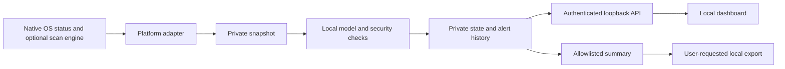

# Architecture

`app.py` owns the loopback API, background collection, scan jobs, local persistence, and CLI. `backends.py` supplies native desktop adapters. `engine.py` assesses snapshots and runs the explainable online behavior model. `privacy.py` creates allowlisted sharing-safe reports. `static/` contains the dashboard; it uses no CDN, analytics, web fonts, or remote scripts.

`ai_evidence.py` derives bounded anonymous indicators and validates structured AI findings against supported evidence. `ai_providers.py` implements explicit inference contracts: fixed loopback Ollama and opt-in restricted Codex/Claude CLI. Only private state retains application identity mappings. Cloud dashboard reviews require single-use provider-bound evidence previews. No result becomes an executable action; provider errors and unsupported results remain unverified. `ai_integrations.py` validates explicitly selected private server/wrapper profiles. Connection tests use fictional evidence without collecting the host. Gemini uses a dedicated restricted vendor profile and fails closed on enterprise policy overrides or missing authentication. See [AI review](AI_REVIEW.md).

Protection and observation are separate. Windows Defender continues independently of the dashboard. POSIX collection does not imply real-time prevention; optional ClamAV actions are folder scans. Unknown engine, firewall, Wi-Fi, process, and connection states remain unknown. Model output never becomes an automatic destructive action.

The model stores per-executable observed sample counts, running means/variance of public TCP connections, and destination-port frequencies. Evaluation occurs before learning. Review signals at or above the threshold are held out of automatic learning. Gateway MAC baselines remain stable after a reported change. Neither a historical baseline nor a MAC change is proof of compromise.

`workbench.py` maintains private review preferences, sensor freshness, bounded observation metrics, protection transitions and scan reminders. `static/workbench.js` renders the controls and local inventory filters. Review/snooze choices never reduce protection-status totals or report counts. Pausing learning freezes model updates while rules continue evaluating. Restart keeps one private `model-backup.json`; restore replaces learned state, invalidates current AI evidence and preserves the historical AI journal. AI results are bound to the exact private snapshot fingerprint, which is never part of provider evidence.

`workbench.json` and the baseline backup live beside private runtime state outside the source tree. Retention applies to collection/advisory history and workbench metrics only; model profiles, backup, scan jobs and AI journals have separate lifetimes. Reminders are opt-in dashboard messages and never schedule scans or background notifications. Both JSON and Markdown exports use allowlisted enums, booleans and counts. See [the fifteen 0.6 features](FEATURES_0_6.md) for limitations.

The local API verifies Host, Origin for mutations, and a random per-instance token. Actions come from a fixed allowlist and are passed as argument arrays. Responses use no-store, no-referrer, nosniff, and a restrictive CSP. State folders are private user-local paths. Same-user programs are outside this isolation boundary.

Native packaging copies only `release-manifest.json` entries into temporary staging. It never reads runtime data as application content. The privacy gate uses known private values only as local rejection seeds; their contents are not printed or shipped. Compiled archives are decompressed for inspection without executing their modules. Release logs, input directories, and Git history are never part of the source archive.
