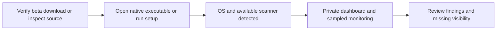
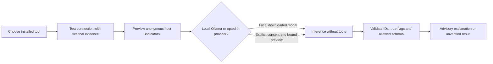
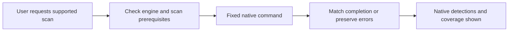

# Sentinel Local user and development workflows

## First run

Opening Sentinel does not start a malware scan, Wi-Fi discovery, AI request, or remediation. [Installation](INSTALLATION.md).

## AI review

There is no cross-provider fallback. AI output cannot become a command, deletion, quarantine, or protection change. Custom wrappers require their owner's permission review. [Provider contracts](AI_REVIEW.md).

## Native malware scan

Windows quick/full scans use Defender; a quick scan completion is matched to a native event. Linux/macOS folder scans require ClamAV and selected roots. Missing permissions, cancellation, skipped coverage, and scanner errors must stay visible. No full scan or Downloads inspection starts on opening the product.

## Source checks in GitHub Actions

`validate.yml` runs on pushes to main, pull requests, and manual dispatch. It uses pinned checkout/Python setup actions, read-only repository permissions, Python 3.11/3.13, and Windows/Linux/macOS runners. Tests use fictional fixtures; self-test does not scan the host. Public source privacy scanning follows those tests. Pull-request code receives no publishing token, signing key, real host reports, or model credentials.

## Native build workflow

`build-native.yml` is manual. Prepared runners cover Windows x64/ARM64, Linux x64/ARM64, and macOS Intel/Apple Silicon. Each builds on the selected native host after tests and privacy checks. Artifacts expire after seven days. A successful build/synthetic smoke test does not establish native engine efficacy, physical Wi-Fi behavior, root-permission coverage, signing, or notarization.

The workflow has no release-publishing or website-deployment step. A maintainer reviews artifacts before an explicitly authorized release. macOS/ARM support stays experimental until actual native checks are recorded. Build dependencies and OS/library baselines are documented in [platform coverage](PLATFORMS.md) and [release preparation](RELEASE.md).

## Public repository privacy

Stage only `release-manifest.json` entries. Source archives omit Git metadata/history and runtime state. Private reports, owner paths, network names/addresses, tokens, real screenshots, and logs cannot be support artifacts. Original public screenshots come only from `tools/demo.py`; see [screenshot provenance](SCREENSHOTS.md).
